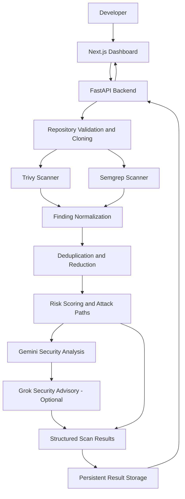

# Fortivo — AI-Powered Application Security Scanner

**Find vulnerabilities. Understand the risk. Visualize attack paths. Prioritize fixes.**

Fortivo is an AI-assisted application security analysis platform that scans code repositories for security vulnerabilities, evaluates their potential impact, and presents actionable findings through an interactive dashboard.

Instead of simply listing scanner alerts, Fortivo combines static analysis, dependency and configuration scanning, risk scoring, and AI-assisted security analysis to help developers understand which vulnerabilities matter most and how they could be exploited together.

## ✨ Features

- **Automated Security Scanning:** Integrates [Semgrep](https://semgrep.dev/) and [Trivy](https://trivy.dev/) to identify code-level security issues, vulnerable dependencies, exposed secrets, and infrastructure misconfigurations.
- **Intelligent Risk Scoring:** Calculates an overall risk score using factors including severity, exploitability, exposure, and potential blast radius.
- **AI-Assisted Analysis:** Uses Google Gemini and optionally xAI Grok to provide contextual security explanations and remediation guidance.
- **Attack Path Visualization:** Connects related findings into plausible multi-step attack scenarios, helping developers understand how individual weaknesses may combine into a larger security risk.
- **Finding Prioritization:** Normalizes and deduplicates scanner results, ranks findings, and highlights the issues that deserve attention first.
- **Interactive Security Dashboard:** Displays risk summaries, severity breakdowns, scan statistics, detailed findings, and attack-path graphs.
- **Finding-Level Explanations:** Presents the nature of a vulnerability, why it matters, and recommended remediation steps.
- **Scan History and Results:** Provides API endpoints to initiate scans and retrieve scan summaries and detailed results.
- **Demo Repository:** Includes a deliberately vulnerable sample application for demonstrating the scanning and analysis workflow.

## 🏗️ Architecture

Fortivo follows a modular architecture that separates the user interface, scanning tools, risk analysis, AI-assisted reasoning, and result storage.



### Analysis pipeline

1. **Repository intake:** Accepts a repository location and validates the input.
2. **Security scanning:** Runs Trivy and Semgrep against the repository.
3. **Normalization:** Converts heterogeneous scanner outputs into a consistent finding format.
4. **Deduplication and reduction:** Groups duplicate findings and selects the most relevant issues to report.
5. **Risk assessment:** Calculates an overall risk score and component scores.
6. **Attack-path analysis:** Identifies plausible relationships between vulnerabilities and constructs multi-step attack scenarios.
7. **AI-assisted reasoning:** Uses available language models to enrich findings and provide security-oriented explanations and advice.
8. **Result presentation:** Stores structured scan results and exposes them through the API for the frontend dashboard.

## 🛠️ Tech Stack

| Layer | Technologies |
|---|---|
| Frontend | Next.js, React, TypeScript |
| Styling and UI | Tailwind CSS, Radix UI |
| Graph visualization | XYFlow / React Flow |
| Backend | Python, FastAPI, Pydantic |
| Static analysis | Semgrep |
| Dependency and configuration scanning | Trivy |
| AI integration | Google Gemini, xAI Grok (optional) |
| Repository handling | GitPython |
| API communication | REST, JSON |
| Deployment | Vercel-compatible frontend and containerized backend |

## 📁 Project Structure

```text
Fortivo/
├── backend/
│   ├── core/
│   │   ├── attack_paths.py
│   │   ├── gemini.py
│   │   ├── grok.py
│   │   ├── llm.py
│   │   ├── pipeline.py
│   │   ├── reduce.py
│   │   ├── risk_agent.py
│   │   └── score.py
│   ├── scanners/
│   │   ├── clone.py
│   │   ├── normalize.py
│   │   ├── scanner_agent.py
│   │   ├── semgrep.py
│   │   └── trivy.py
│   ├── utils/
│   │   └── validators.py
│   ├── Dockerfile
│   ├── main.py
│   ├── models.py
│   ├── storage.py
│   └── requirements.txt
├── frontend/
│   ├── app/
│   ├── components/
│   ├── lib/
│   ├── package.json
│   └── ...
├── demo-app/
├── docs/
├── fixtures/
├── results/
├── .env.example
├── CONTRACT.md
├── DECISIONS.md
└── README.md
```

## 🚀 Getting Started

### Prerequisites

Install the following before running Fortivo:

- Python 3.10 or later
- Node.js and npm
- Git
- [Trivy](https://trivy.dev/) installed and available on your `PATH`
- [Semgrep](https://semgrep.dev/docs/getting-started/) installed and available on your `PATH`
- A Google Gemini API key for AI-assisted analysis
- An xAI API key if you want to use the optional Grok integration

### 1. Clone the repository

```bash
git clone https://github.com/Sindhu2818/Fortivo.git
cd Fortivo
```

Replace the repository URL if you are working from a fork or a differently named repository.

### 2. Configure environment variables

Create a `.env` file in the project root:

```bash
cp .env.example .env
```

Configure the relevant variables:

```dotenv
# AI configuration
GEMINI_API_KEY=your_gemini_api_key
GEMINI_MODEL=gemini-2.5-flash

# Optional Grok integration
GROK_API_KEY=
GROK_MODEL=grok-4

# Backend configuration
BACKEND_HOST=127.0.0.1
BACKEND_PORT=8000
LOG_LEVEL=INFO

# Frontend configuration
NEXT_PUBLIC_API_URL=http://127.0.0.1:8000
NEXT_PUBLIC_DEMO_MODE=false

# Scanner binaries
TRIVY_PATH=trivy
SEMGREP_PATH=semgrep

# Optional resource limits
MAX_REPO_SIZE_MB=500
SCAN_TIMEOUT=600
```

Obtain API keys from [Google AI Studio](https://aistudio.google.com/app/apikey) and, if needed, the [xAI Console](https://console.x.ai/).

Keep your actual `.env` file private. Never commit API keys or other secrets to version control.

### 3. Set up the backend

From the repository root:

```bash
python -m venv .venv
```

Activate the environment.

**Linux / macOS**

```bash
source .venv/bin/activate
```

**Windows PowerShell**

```powershell
.venv\Scripts\Activate.ps1
```

Install dependencies and start the API:

```bash
pip install -r backend/requirements.txt
cd backend
uvicorn main:app --host 127.0.0.1 --port 8000 --reload
```

The backend should now be available at:

- API base URL: `http://127.0.0.1:8000`
- Interactive API documentation: `http://127.0.0.1:8000/docs`
- Health check: `http://127.0.0.1:8000/health`

### 4. Set up the frontend

Open a second terminal from the repository root:

```bash
cd frontend
npm install
npm run dev
```

Open `http://localhost:3000` in your browser.

Ensure that `NEXT_PUBLIC_API_URL` points to the running backend. Restart the frontend development server after changing environment variables.

### 5. Run your first scan

From the dashboard, submit a repository location supported by the backend.

You can also initiate a scan directly through the API:

```bash
curl -X POST http://127.0.0.1:8000/scan \
  -H "Content-Type: application/json" \
  -d '{"repo_url":"https://github.com/owner/repository"}'
```

For a local test, the included sample application can be used as input:

```bash
curl -X POST http://127.0.0.1:8000/scan \
  -H "Content-Type: application/json" \
  -d '{"repo_url":"./demo-app"}'
```

The API returns a scan identifier. Use it to retrieve the scan's detailed results.

**Important:** `demo-app/` intentionally contains vulnerable code and insecure configurations. Use it only in an isolated, controlled demonstration environment. Do not deploy it as a real application or expose it to the public internet.

## 🔌 API Reference

The FastAPI backend exposes the following primary endpoints.

| Method | Endpoint | Description |
|---|---|---|
| `GET` | `/health` | Checks whether the backend is running |
| `POST` | `/scan` | Initiates a repository scan |
| `GET` | `/results` | Retrieves available scan summaries |
| `GET` | `/results/{scan_id}` | Retrieves the detailed results for a scan |

### Example response

A successful scan submission returns a response containing a scan identifier and status:

```json
{
  "scan_id": "scan_20261027_142301",
  "status": "running"
}
```

The identifier and status above are illustrative. The actual values are generated by the application.

Retrieve the results using:

```bash
curl http://127.0.0.1:8000/results
```

Or retrieve one scan:

```bash
curl http://127.0.0.1:8000/results/YOUR_SCAN_ID
```

Detailed results include structured risk information, scan statistics, security findings, remediation guidance, and attack paths, where available.

For the complete request and response schemas, open the interactive API documentation at `/docs` or consult `CONTRACT.md`.

## 📊 Understanding Risk Scores

Fortivo evaluates security findings using several risk dimensions:

- **Severity:** How serious the underlying vulnerability is.
- **Exploitability:** How readily an attacker might exploit the weakness.
- **Exposure:** How accessible the affected component is.
- **Blast radius:** The potential scope of impact if exploitation succeeds.

These dimensions contribute to an overall risk score and risk category. The dashboard presents the resulting assessment alongside individual findings and their contribution to the analysis.

Risk scores are prioritization aids, not guarantees of exploitability or proof that a system is secure.

## 🧪 Testing and Demo Data

The repository includes:

- `demo-app/` — a deliberately vulnerable application for controlled demonstrations.
- `fixtures/` — representative scanner outputs and mock results for development and testing.
- `CONTRACT.md` — the canonical result schema and API contract.

The fixtures can help with understanding the expected data format and developing against representative scanner results.

## 🔐 Security Considerations

- Never expose API keys, credentials, or sensitive environment variables in source control.
- Scan only repositories you own or are explicitly authorized to assess.
- Treat source code, scanner output, and AI-generated recommendations as potentially sensitive.
- Run scans in an appropriately isolated environment, particularly for untrusted repositories.
- Restrict access to scan results if repositories contain proprietary information.
- Review AI-generated explanations and remediation recommendations before applying changes.
- Keep Trivy, Semgrep, Python dependencies, Node.js dependencies, and the deployment environment updated.

Fortivo is a security analysis and prioritization tool. Its findings may contain false positives or false negatives and should be validated as part of a broader security review.

## 🗺️ Roadmap

Potential future improvements include:

- Expanded scanner integrations and language coverage.
- Improved contextual risk scoring and attack-path correlation.
- Historical comparisons and vulnerability trend analysis.
- More comprehensive remediation verification.
- CI/CD integration for automated security checks.
- Exportable security reports and team-oriented workflows.

## 🤝 Contributing

Contributions, bug reports, and feature suggestions are welcome.

1. Fork the repository.
2. Create a feature branch.
3. Implement and test your changes.
4. Submit a pull request describing the change and its motivation.

Please avoid committing credentials, private repository data, generated scan results, or other sensitive information.

## 📄 License

No license file was identified in the supplied project archive. Add a `LICENSE` file and update this section before distributing the project under an open-source license.

---

**Fortivo** — Turning security findings into actionable risk insights.
